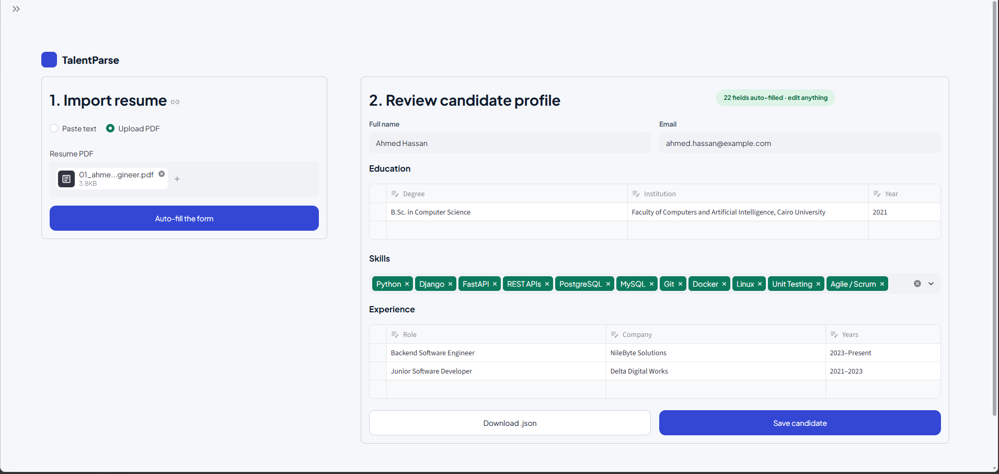

# 🚀 [Tips Hindawi](https://www.tipshindawi.com/) Internship (August–October) 2026

> 🎓 This project was built during the [ **Tips Hindawi** ](https://www.tipshindawi.com/) **Internship (August–October) 2026**.

## 👤 Participant

| Field            | Value                                |
| ---------------- | ------------------------------------ |
| Full Name        | Mariam Ebrahim Mahfouz Mohammed      |
| Project Name     | TalentParse: HR Candidate Profile Parser |
| GitHub Username  | Mariam-Ebrahim                       |
| Internship Batch | August–October 2026                  |
| Training Program | Large Language Models (LLMs) Program |
| Organization     | [**Edrak for Ai**](https://edrak4ai.com/en)                         |

---

# 📖 Project Overview

**TalentParse** reads a resume and turns it into a clean, structured candidate profile. An LLM extracts the data, LangChain's `StructuredOutputParser` checks it against a fixed schema, and the result appears as an **auto-filled, editable form**, like the forms job sites show after you import a resume. The reviewer fixes any cell, then saves the candidate or downloads the JSON.

The output follows the lab's schema:

```json
{
  "full_name": "John Smith",
  "email": "john.smith@email.com",
  "education": [{"degree": "B.Sc. Computer Science", "institution": "MIT", "year": 2020}],
  "skills": ["Python", "Machine Learning", "Data Analysis"],
  "experience": [
    {"role": "Software Engineer", "company": "Google", "years": "2020–2023"},
    {"role": "Data Scientist", "company": "OpenAI", "years": "2023–Present"}
  ]
}
```

How it works:

```
Resume PDF → text → prompt → LLM (Kaggle, via ngrok) → JSON → validate and clean → editable form
```

---

# ✨ Features

* Upload a resume PDF (or paste the text) and auto-fill the candidate form
* LLM extraction validated with LangChain `StructuredOutputParser`
* Automatic cleaning: year numbers, date ranges, duplicate skills
* Editable form: change any cell, add or remove education and experience rows, add or remove skills
* Download the profile as JSON, or save candidates to a local file
* Works with any LLM server through a simple FastAPI endpoint
* Demo mode without a GPU, plus automated tests

---

# 🛠️ Technologies Used

* **Python**, **Streamlit** (interface), **pandas**
* **LangChain** (`StructuredOutputParser`, prompt templates)
* **Hugging Face Transformers**: `Qwen/Qwen2.5-3B-Instruct` (free, fast model)
* **FastAPI** + **ngrok**: serve the model from a Kaggle GPU notebook
* **pypdf**: read text from PDF resumes
* **pytest**: automated tests

---

# ⚙️ Installation

**You need:** Python 3.10+, a free [Kaggle](https://www.kaggle.com/) account (it may ask for phone verification to enable GPU and Internet), and a free [ngrok](https://ngrok.com/) account.

### 1. Get the code and install the libraries

```bash
git clone https://github.com/Mariam-Ebrahim/talent-parse-hr-candidate-profile-parser.git
cd talent-parse-hr-candidate-profile-parser
python -m venv .venv
.venv\Scripts\activate            # Mac/Linux: source .venv/bin/activate
pip install -r requirements-dev.txt
pytest                            # optional: check that everything works
```

### 2. Start the model server on Kaggle

1. Create a new Kaggle notebook. In the settings choose **GPU** and turn **Internet on**.
2. In *Add-ons → Secrets* add two secrets:
   * `NGROK_TOKEN`: your ngrok authtoken
   * `API_KEY`: any long random password you invent
3. Run these cells:

```python
!pip install -q transformers==4.52.4 accelerate bitsandbytes fastapi uvicorn pyngrok
```
```python
%%writefile llm_server.py
# paste the full content of server/llm_server.py here
```
```python
!python llm_server.py
```

4. Wait for the line `PUBLIC URL: https://....ngrok-free.app` and copy it. **Keep the cell running.** The URL changes every time you restart it.

The model is set by `MODEL_NAME` in `server/llm_server.py` (default: `Qwen/Qwen2.5-3B-Instruct`).

### 3. Run the app

```bash
streamlit run app.py
```

In the sidebar choose **Remote LLM**, then paste the ngrok URL and your `API_KEY`. (Or copy `.env.example` to `.env` and fill the two values.)

---

# 🚀 Usage

1. Open the app at `http://localhost:8501`.
2. Upload a resume PDF in **1. Import resume** and press **Auto-fill the form**.
3. Review **2. Review candidate profile**: edit any cell, add or remove rows and skills.
4. Press **Download .json** to get the file, or **Save candidate** to add it to `output/candidates.json`.

No GPU or Kaggle yet? Choose **Demo (no GPU)** in the sidebar. It uses a simple rule-based parser that only understands the sample layout in `sample/`.

---

# 📸 Demo



*The sample resume is a fictional candidate.*

---

# 📈 Results

* Turns a resume PDF into the lab's JSON schema: name, email, education, skills and experience. For the sample resume above, 22 fields were filled in automatically.
* The editable form lets the reviewer fix model mistakes before saving, and the downloaded JSON always matches what is on screen.
* Automated tests cover the cleaning rules, the parsing pipeline and the interface flow.

---

# 🔮 Future Improvements

* OCR for scanned resumes and photos
* Support for Word (.docx) files and Arabic resumes
* Parse many resumes at once and compare candidates in a table
* Show a confidence marker for each field

---

# 📚 About the Internship

This project was developed as part of the [**Tips Hindawi**](https://www.tipshindawi.com/) **Internship (August–October) 2026**, and it will be showcased on the official [Tips Hindawi](https://www.tipshindawi.com/) website.

[Tips Hindawi](https://www.tipshindawi.com/) is the internships department of [**Edrak for Ai**](https://edrak4ai.com/en), and the internship encourages participants to build real-world projects, apply practical skills, and showcase their work through GitHub.

For more information about the internship, training programs, and upcoming batches, visit the official [Tips Hindawi](https://www.tipshindawi.com/) website.

---

# 📄 License

This project is shared for educational and portfolio purposes.
